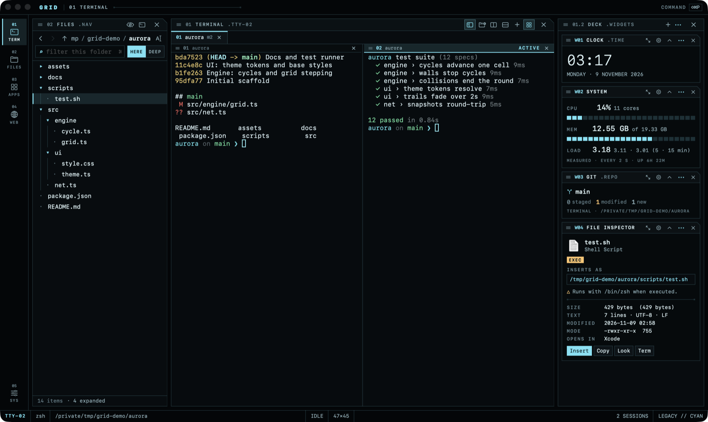
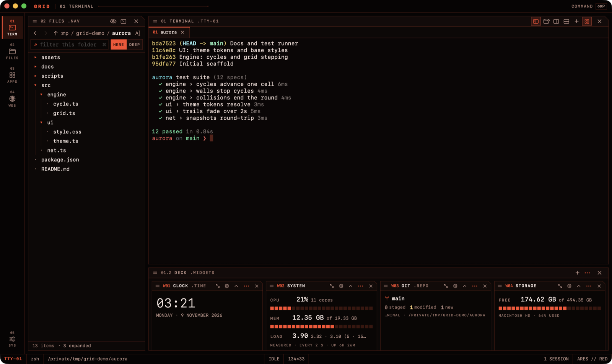
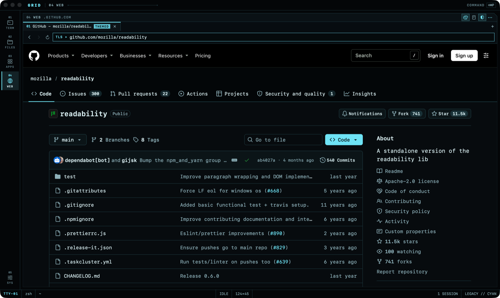
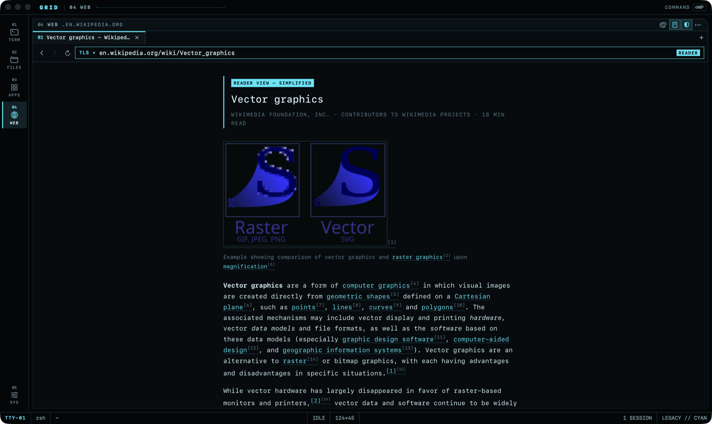
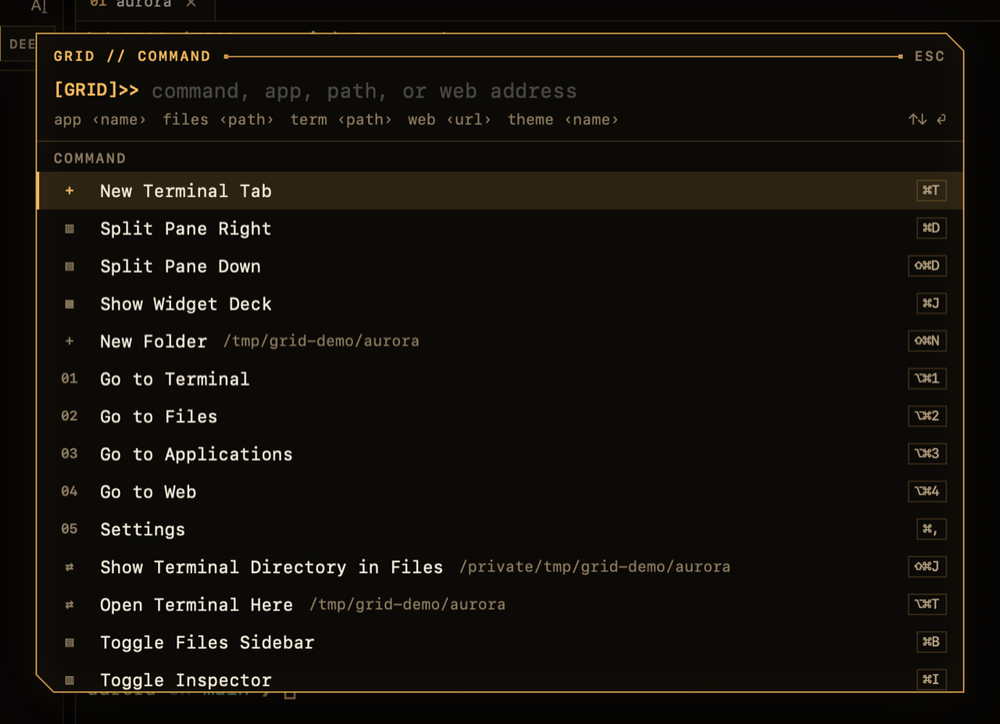

<div align="center">

# GRID

**A terminal-first workspace for macOS.**<br>
A real terminal, a file browser, an app launcher, a widget deck and a web browser in one keyboard-driven window, styled after the production design of *Tron: Legacy* and *Tron: Ares*.

[](#requirements)
[](Package.swift)
[](#requirements)
[](https://github.com/HackitM/grid/releases/latest)

[**Download**](https://github.com/HackitM/grid/releases/latest) · [Features](#features) · [Install](#install) · [Build from source](#build-from-source) · [Shortcuts](#keyboard-shortcuts) · [Docs](#documentation)



</div>

## Why GRID?

- **The terminal comes first.** Your real login shell in a native terminal ([SwiftTerm](https://github.com/migueldeicaza/SwiftTerm)) with tabs, splits and find. Everything else sits around it.
- **Everything is one keystroke away.** Files, apps, settings and web pages all open from the command palette (⇧⌘P), and every shortcut can be changed.
- **Native and lightweight.** Swift, SwiftUI and AppKit, with WebKit for the browser. No Electron, no background services.
- **Private by default.** No accounts, no telemetry, no cloud. Your data stays on your Mac ([details](#privacy--security)).

## Features

### Terminal
- Your login shell (zsh by default) with your usual PATH and dotfiles, in tabs and **split panes** (up to six per tab, any direction, draggable dividers).
- **Find** with case, regex and whole-word options; renamable tabs; busy, finished-job and bell indicators.
- **Drag files in safely:** dropped paths are inserted quoted and are **never run** for you.
- GRID tracks each session's working directory, so the Files panel and widgets can follow it.

### Files
- A file browser with breadcrumbs, history, an editable path, sorting, filtering and a deep recursive search.
- Folders **expand in place** as a tree (▸, or → / ←; ⌥ expands three levels).
- Everyday file operations: new folder, rename, duplicate, copy / paste / move, Move to Trash, multi-step undo, Quick Look and Open With.
- The **File Inspector** shows exactly what a file will insert into the terminal before you drag it, and warns about executables and downloaded files.

### A workspace you arrange



- **Dockable panels.** Drag Files, Terminal or the Widget Deck by its title bar to any edge of another panel. Terminal panes and tabs move the same way. The layout is saved.
- **Widget deck (⌘J).** Clock, System, Network, Storage, Power, Sessions, Pinned Apps, Git, Notes, Recent Files and the File Inspector, all showing real measurements. Drop a card beside another for side-by-side rows, which works well with the deck docked at the bottom.
- **Build your own widgets.** A widget is a folder with a `manifest.json` and some JavaScript. GRID draws it with its own components, so it always matches the design. Widgets run in a sandboxed helper process and can only use what you approve. See the [Widget API](docs/WIDGETS.md) and [nine examples](widgets/examples).

### Built-in browser

<table>
  <tr>
    <td width="50%"></td>
    <td width="50%"></td>
  </tr>
  <tr>
    <td align="center"><sub>Site theme on GitHub</sub></td>
    <td align="center"><sub>Reader view (⇧⌘R)</sub></td>
  </tr>
</table>

- A full WebKit browser (Safari's engine) drawn in GRID's style: tabs, address bar with search, find, zoom and history.
- **New tab page** with a slowly turning dot-matrix globe (drawn on the GPU, paused whenever it isn't in view), your recent pages and a status readout.
- **Site themes** give GitHub, Hacker News, MDN, Wikipedia, Stack Overflow and Google Search GRID's colours and type. You can toggle them per site, and they follow your GRID theme.
- **Reader view** re-sets articles in GRID's monospaced layout.
- **Ad blocking** uses uBlock Origin's default filter lists through Safari's built-in content blocker, with a one-click "off for this site".
- **Extensions** in Chrome / Safari WebExtension format (macOS 15.4+) install after a permission review. Their buttons only appear once one is installed.
- Web pages can't reach your terminal, files or apps. Downloads always ask first.

### Command palette and themes



**⇧⌘P** opens the palette for commands, apps, folders and web addresses. It understands a small grammar:

```text
app Safari
files ~/Projects
term ~/Projects
web example.com
theme ares
```

Palette commands are GRID commands. They are never sent to your shell.

Three themes: **Legacy** (cyan), **Ares** (red) and **ENCOM** (amber). Glow, motion and the grid backdrop can each be turned off, and GRID respects Reduce Motion.

Right-click and "⋯" menus are drawn in the same style, including web page menus and a terminal menu (Copy, Paste, Split…). You can switch back to standard macOS menus in **Settings › Effects**, and VoiceOver always gets standard menus.

<br clear="right">

## Install

1. Download **GRID-x.y.z-macOS.zip** from the [latest release](https://github.com/HackitM/grid/releases/latest), unzip it and move **GRID.app** to Applications.
2. GRID isn't notarized by Apple yet, so macOS blocks the first launch. Open it once, then go to **System Settings › Privacy & Security** and click **Open Anyway**. You only need to do this once.
3. Optional: verify the download against the `.sha256` file from the same release:
   ```bash
   shasum -a 256 GRID-0.4.0-macOS.zip
   ```

### Requirements
- macOS 15 Sequoia or later (browser extensions need macOS 15.4)
- Apple silicon

### First run
- The first time a shell or the Files panel touches **Desktop, Documents, Downloads** or a removable or network volume, macOS asks for permission. That's the normal macOS privacy system, and GRID doesn't try to get around it. The command waits until you answer.
- Your shell starts as a login shell, so it behaves just like it does in Terminal.app.

## Keyboard shortcuts

| Keys | Action |
|---|---|
| **⇧⌘P** | Command palette (or ⌘K, ⇧⌘Space; set in Settings) |
| **⌘T** / **⌘W** | New tab / close pane or tab |
| **⌘D** / **⇧⌘D** | Split pane right / down |
| **⌥⌘← ⌥⌘→** | Move between panes |
| **⌘1…⌘9**, **⇧⌘[ ⇧⌘]** | Select or cycle tabs |
| **⌘F**, **⌘G** / **⇧⌘G** | Find, next / previous |
| **⌘B** / **⌘J** | Show or hide Files / Widget Deck |
| **⌥⌘1…⌥⌘4**, **⌘,** | Terminal · Files · Apps · Web · Settings |
| **⌥⌘T** / **⇧⌘J** | New terminal in this folder / show the terminal's folder in Files |
| **⇧⌘R** | Reader view (browser) |

<details>
<summary><b>All shortcuts</b></summary>

| Keys | Action |
|---|---|
| ⇧⌘W | Close tab |
| ⌥⌘0 | Show or hide the Terminal panel |
| ⌘I | Files inspector |
| ⌘K | Clear scrollback |
| ⌘L, ⌘F, ⌘[ ⌘] ⌘↑, ⇧⌘. | Files: path · filter · back / forward / up · hidden files |
| ⇧⌘N, ⌘C ⌘V ⌥⌘V, ⌘⌫, ⌘Z | Files: new folder · copy / paste / move · Move to Trash · undo |
| Space, ⇧↑↓, ⌘A, ⌘-click ⇧-click | Files: Quick Look · multi-select |
| ▸ click, → / ←, ⌥→ | Files: expand / collapse folders in place (⌥ expands three levels) |
| ⌘T ⌘W ⌘F ⌘L ⌘R ⌘[ ⌘] | Browser: new tab · close tab · find · address bar · reload · back / forward |
| ⇧⌘[ ⇧⌘] | Browser: previous / next tab |

</details>

Every shortcut except ⌘1–⌘9 can be changed in **Settings › Keyboard**: click a shortcut and press the new keys. Shortcuts must include ⌘ (or be F1–F12) so they never take keys from programs running in the terminal.

## Build from source

You need Xcode 16.3 or later (GRID is developed with Xcode 27 and Swift 6.4). There are no other dependencies to install, because Swift Package Manager fetches them.

```bash
git clone https://github.com/HackitM/grid.git
cd grid
scripts/bundle.sh        # release build -> build/GRID.app
open build/GRID.app
```

For development:

```bash
swift build              # compile
swift test               # run the unit tests
scripts/bundle.sh debug  # debug build of the .app
open Package.swift       # work in Xcode (run the "Grid" scheme)
```

Use the `.app` bundle for real use rather than `swift run`, since macOS privacy prompts, the Dock icon and LaunchServices all need a bundle identifier.

## Privacy & security

- **No accounts, telemetry, cloud services or AI features.** Settings, browsing data and history stay on your Mac. Terminal contents are never logged or stored.
- **Network requests GRID makes on its own:** downloading the ad-blocking filter lists from their publishers (only while ad blocking is on), and Safari's standard fraudulent-site check in the browser. Everything else happens because you asked for it.
- **Web content is isolated.** Pages get no bridge into GRID, can't run commands, and can't open other apps without a click and a confirmation. Downloads are confirmed and quarantined like Safari's.
- **Widgets are sandboxed.** Custom widgets run in a separate, locked-down process and only get the permissions you approve. Those are shown in plain words, with the exact commands, paths and hosts.
- **macOS protections stay on.** GRID isn't App-Sandboxed (your shell needs to reach your files), so it ships outside the Mac App Store. It never tries to work around macOS privacy prompts.

See [docs/ARCHITECTURE.md](docs/ARCHITECTURE.md) for the full security model.

## Known limitations

- Not notarized yet (see [Install](#install)).
- A terminal tab holds up to six panes.
- Directory tracking follows the shell process, not `ssh` sessions or subshells.
- Dragging several items into Finder carries only the first one (an AppKit / SwiftUI limitation). Drags into GRID's terminal carry them all.
- The Git widget runs `git status`. Like any prompt that shows git status, a malicious repository's config could run commands, so point it only at repositories you trust.
- Some ads that uBlock Origin removes with page scripts (for example on YouTube) can't be blocked by Safari's content blocker.
- App discovery scans the standard Applications folders, up to three levels deep.

## Documentation

| Document | What's in it |
|---|---|
| [WIDGETS.md](docs/WIDGETS.md) | Widget API: build and share your own widgets |
| [ARCHITECTURE.md](docs/ARCHITECTURE.md) | Architecture, security model, technology choices |
| [DESIGN.md](docs/DESIGN.md) | Visual spec and design tokens |
| [TESTING.md](docs/TESTING.md) | Automated tests, QA hooks and manual checklist |
| [PLAN.md](docs/PLAN.md) | Roadmap: what's done and what's next |
| [releases/](docs/releases) | Release notes |

## Development

```text
Sources/GridCore        Core logic (paths, shell quoting, layout, ad-block filters, widget packages); unit-tested
Sources/Grid            The app: SwiftUI + AppKit views, terminal, files, widgets, browser
Sources/GridWidgetHost  Sandboxed helper process that runs custom widgets
Tests/GridCoreTests     Unit tests (swift test)
widgets/examples        Example widget packages
scripts/                bundle.sh (build the .app), release.sh (publish a release)
```

Debug builds include automation hooks for UI testing. They're only active when launched with `--args --qa`. See [docs/TESTING.md](docs/TESTING.md).

### Releasing

1. Bump `CFBundleShortVersionString` in `Resources/Info.plist`.
2. Write `docs/releases/<version>.md`.
3. Commit, then run `scripts/release.sh <version>`.

The script runs the tests, builds into `dist/`, zips the app with a SHA-256 checksum, tags `v<version>` and publishes a GitHub Release with the notes.

To sign and notarize with your own Developer ID:

```bash
SIGN_ID="Developer ID Application: Your Name (TEAMID)" scripts/bundle.sh
ditto -c -k --keepParent build/GRID.app build/GRID.zip
xcrun notarytool submit build/GRID.zip --keychain-profile <profile> --wait
xcrun stapler staple build/GRID.app
```

## Acknowledgements

- [SwiftTerm](https://github.com/migueldeicaza/SwiftTerm) powers the terminal.
- [Readability.js](https://github.com/mozilla/readability) from Mozilla powers reader view.
- [uBlock Origin](https://github.com/gorhill/uBlock)'s default filter lists (EasyList, EasyPrivacy, Peter Lowe's list and uBlock filters) power ad blocking.

Third-party licenses are listed in [LICENSES.md](LICENSES.md). Include SwiftTerm's MIT notice when you distribute binaries.

GRID is an independent fan project inspired by the look of the *Tron* films. It isn't affiliated with or endorsed by Disney.
